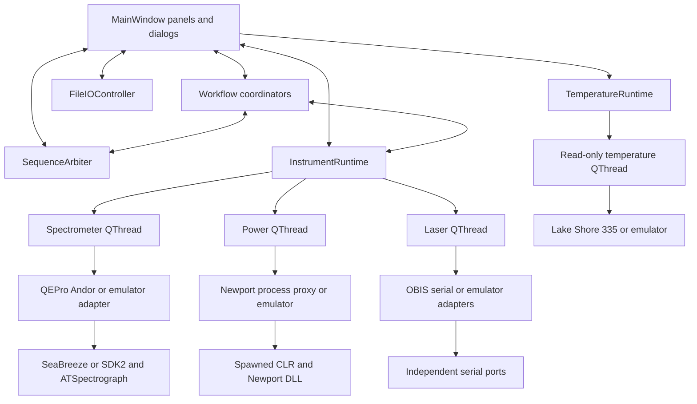
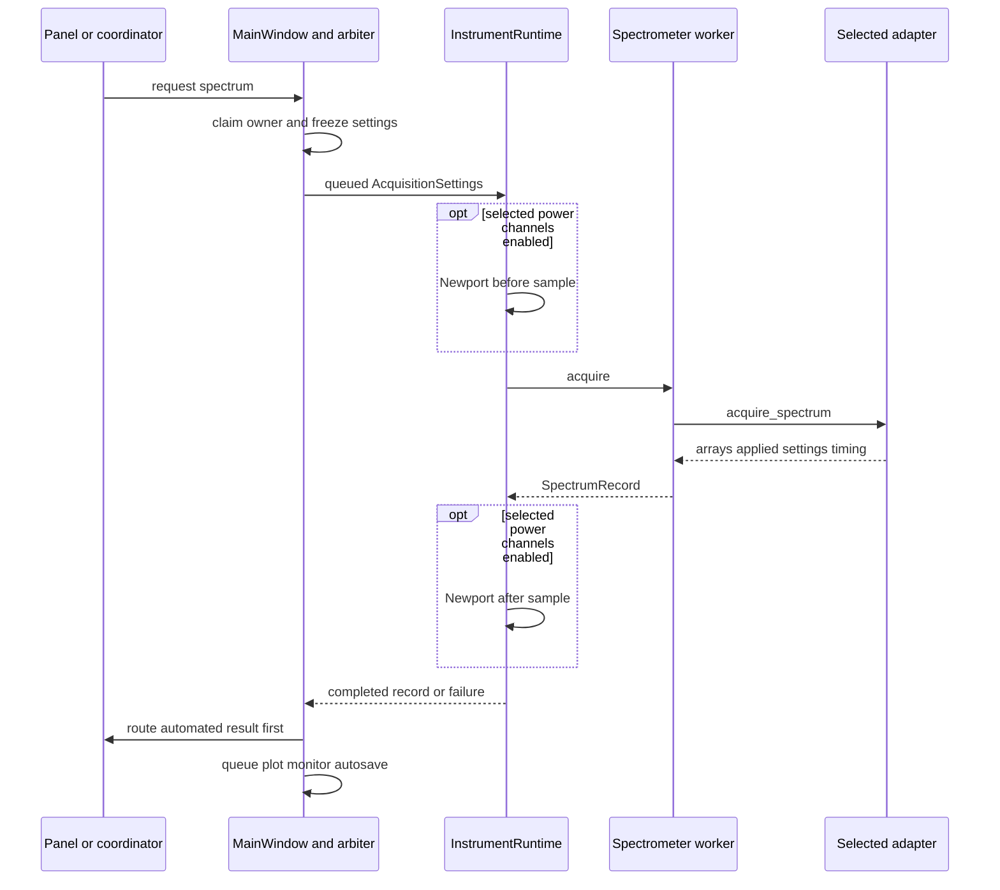
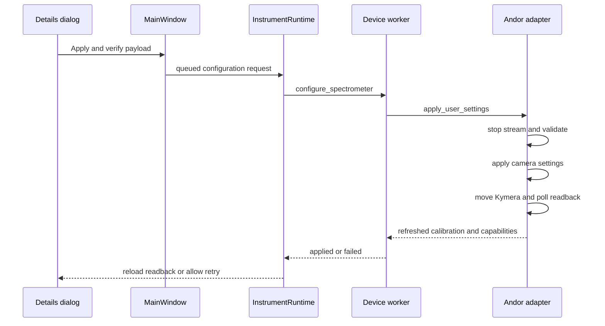
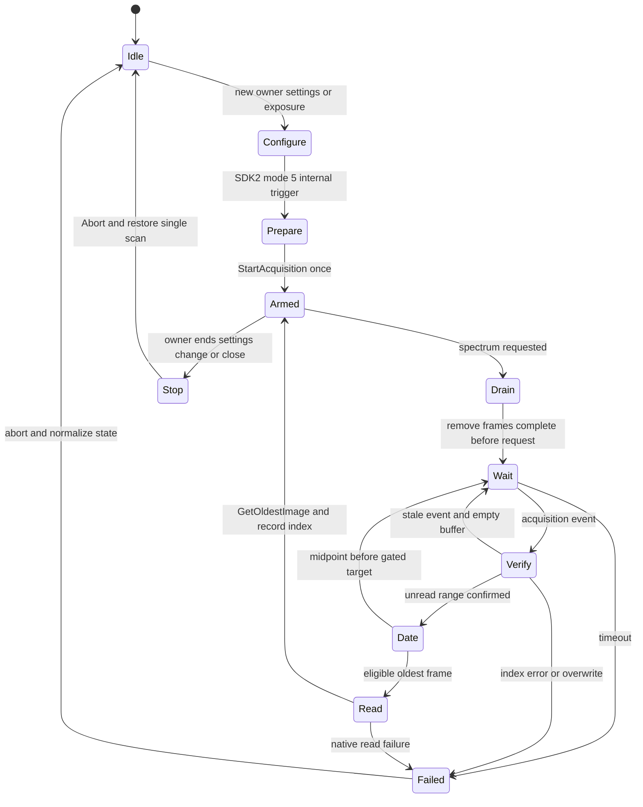
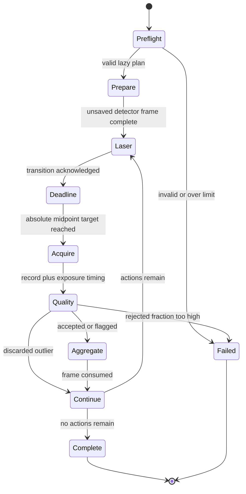
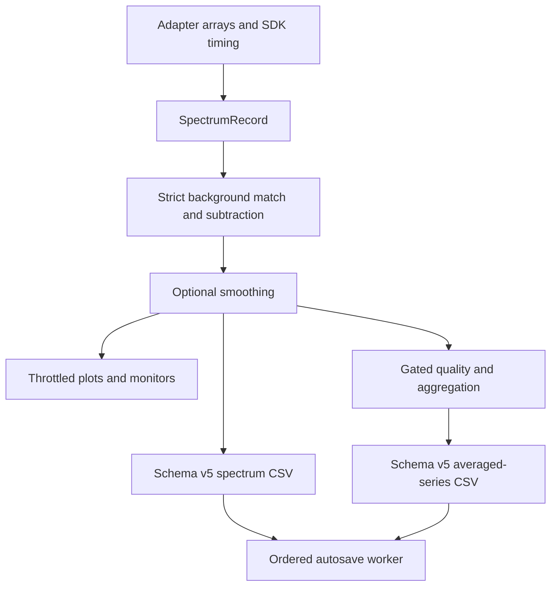
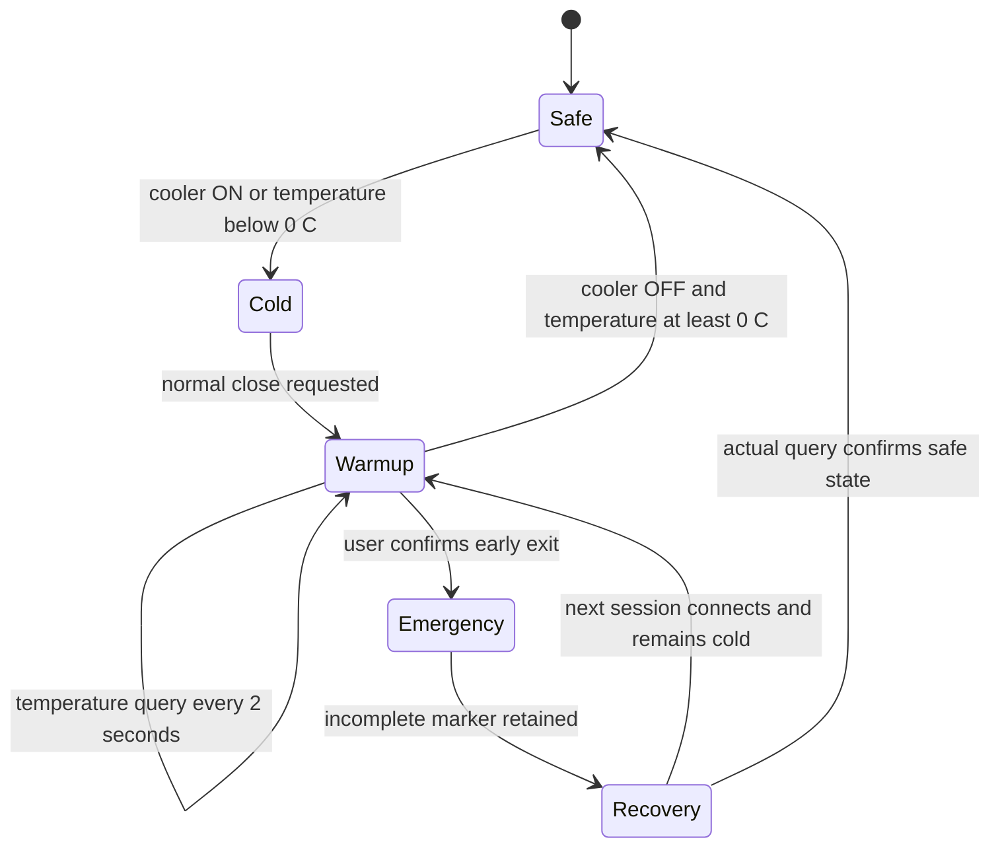

# Spectrometer GUI architecture

Updated: 2026-10-07 release continued 2026-10-08

## October 7 changes

The current detailed design is in
[the feature and architecture guide](docs/GUI_FEATURES_DESIGN_AND_ARCHITECTURE_20261007.md).
Scans share a left-side selector; underlying coordinators and ownership are unchanged.
Acquisition control gating is centralized, plot layers are explicit, and PaddedViewBox
provides separate x/y auto margins. SNR supports vectorized local-block estimates
with a benchmark record and retained manual windows.

AnalysisPanel owns a separate workspace of SpectralTrace copies. Pure numerical
functions implement baselines, response correction/profile generation, stitching,
residuals and peak/band metrics. QRunnable jobs return through queued GUI signals.
Analysis does not command instruments or alter acquisition autosave/monitor data.
Derived spectra and profiles use separate versioned file types with ordered provenance.
Imported laboratory detector IDs are explicit, not silently mapped to SDK indices.

The September 14 connection path is preserved (17 source comparisons). No I2C or
gated timing changes were added. Real Qt/hardware acceptance remains open.

## October 6 extensions

`ParameterScanCoordinator` uses a new `parameter_scan` lease for ordinary exposure,
Kymera-center, elapsed-time and temperature-condition scans. It routes through the
existing runtime and returns one spectrum per point; it does not call the gated
coordinator. Pure plan validation caps each run at 10000 acquisitions. Queued
configuration acknowledgements, settle deadlines and fresh sampled-temperature
dwell gates precede acquisition. Overruns serialize every requested time point.
Cancellation drains the in-flight operation; optional Kymera restoration retains
the lease until its worker callback. Each run has a UUID and terminal summary.

`TemperatureRuntime` owns an additional independent QThread and read-only
`LakeShore335` adapter. Its explicit COM/emulator connection is session-scoped.
No heater/setpoint command is implemented. ADC validity, monotonic sample age and
identity accompany A/B kelvin readings. CCD queries stay on the spectrometer worker.

Spectrum CSV v5 adds post-background pre-smoothing values and ordinary-scan
metadata. The three arrays are distinct: raw adapter output, unsmoothed corrected
signal, final displayed signal. SpectrumPanel shows both latter stages when
smoothing is active; captured background has a separate labeled overlay.
Gated averaged-series schema v5 remains unchanged as a distinct file type.

Power channel selection now reaches scalar metrics, normalization, map/3D values,
power statistics and export. Resetting either monitor rebases retained elapsed
values and preserves UTC timestamps. Full-run power logs and workflow clocks keep
their original origin.

See `REVIEW_20261006.md`, `CHANGELOG_20261006.md` and the October 6 documents for
operating contracts, verification evidence and the remaining hardware gates.

## Design rules

The application separates presentation, workflow coordination, cross-instrument
routing, device ownership, and persistence. A device adapter never calls another
device adapter. Spectrometer, power meter, and laser sources can each be real,
emulated, or disconnected independently. Any workflow that combines them does so
through host-owned coordinators and the runtime.

`SequenceArbiter` grants one acquisition workflow owner at a time. Device calls
execute only on their owning worker thread. Newport additionally runs behind a
restartable child-process boundary so process-global CLR/vendor state can be
discarded after a power cycle.

## System topology

The GUI thread owns widgets, state-machine callbacks, plot queuing, status, and
file dialogs. The spectrometer worker owns background state and record formation.
The runtime owns optional before/after Newport association across independent
queues. A slow Newport request therefore delays only a spectrum that explicitly
requires it; unrelated live Newport polling and spectrometer work remain separate.

## Acquisition communication path

`MainWindow._request_spectrum()` emits the worker request before repainting status
controls. `MainWindow._on_spectrum_ready()` clears the one-call busy state and
routes gated, power-scan, or auto-tune results before plot/monitor analysis. This
lets the owning state machine schedule its next deadline with minimal GUI work in
front of it.

For an acquisition with spectrum-associated power, `InstrumentRuntime` runs a
small transaction: validated Newport-before, spectrometer request, validated
Newport-after, record delivery. `PowerReadRequest.required_channels` determines
validity. The complete two-channel snapshot remains available for warnings; the
serializer persists only the associated channels.

## Spectrometer settings communication path

The dialog captures the payload before disabling its widgets, remains open while
the worker transaction is pending, and prevents silent close with unapplied edits.
Kymera motion is serialized: grating readback must match before a wavelength for
that grating is sent. Queryable grating, wavelength, filter, flipper, focus, and
offset values must agree before success is reported. SDK2 does not expose matching
getters for all camera readout indices, so those are confirmed by successful native
setter returns, cached as the active configuration, and exercised by the next
acquisition. `troubleshooting.andor_controls_probe` uses this same adapter path and
restores test changes by default.

Capabilities are evidence-gated. The 2026-09-14 controls run verified grating,
center wavelength, filter, flipper, horizontal/vertical speed, and available gain
changes. The tested FVB path rejected binning 4 with `DRV_NOT_SUPPORTED`, so the
production schema exposes only binning 1. Focus position readback remains visible,
but its editor is disabled because a reversible set request returned
`ATSPECTROGRAPH_P2INVALID`; the diagnostic probe still exposes the native call so
its range/semantics can be resolved without advertising an unverified GUI control.

## Andor streaming path

`AndorSDK2Camera` keys an armed stream by complete camera settings, requested
exposure, and workflow session. `GetNumberNewImages` supplies unread driver
indices. A request drains frames already completed at entry. For ordinary rapid
acquisition it returns the next oldest unread completion. For an OFF-frame gated
request, it dates that candidate from applied exposure/readout timing and rejects
it if its estimated exposure midpoint precedes the absolute target. Selection
continues under one bounded deadline. If multiple frames are pending, the oldest
completion is estimated from its distance behind the newest image and the SDK
kinetic-cycle value. Invalid ranges and evidence that the circular buffer skipped
an expected index fail explicitly rather than returning an ambiguous frame.

SDK2 acquisition notifications and circular-buffer data are separate: after a
drain, the adapter ignores a successful wait unless `GetNumberNewImages` also
confirms unread data. `AcquisitionTiming` carries mode, driver index, pre-request
and target-alignment discard counts, pending depth, applied exposure, readout,
kinetic cycle, sample windows, midpoint, basis, and uncertainty.

Live, gated, power-scan, and auto-tune owners use stable session names. Gated
acquisition makes one unsaved preparation call before any laser-timed action so
the approximately 0.9 second first preparation never occurs after laser OFF.

## Gated planning and execution

`planning.gated_sequence.build_gated_plan()` is pure and constant-size for
preflight: it validates, computes frame/action counts and retained-memory bounds,
and produces five compact semantic preview rows. `LazyGatedActionSequence`
creates frame/action objects only as the coordinator consumes them. The
representative 1,001-frame decay plan takes about 0.041 ms in the review runtime;
moving it to another thread would cost more than the work itself.

The coordinator schedules absolute `perf_counter_ns` deadlines. For laser-OFF
frames it passes the absolute requested exposure-midpoint target through the
immutable acquisition settings to the selected detector. It then evaluates the
returned exposure-midpoint residual. A rolling, bounded baseline is shared across
runs by spectrometer backend and gated mode. Auto policy discards averaged
outliers and flags individual output. A sustained rejected fraction fails the run;
accepted partial averages survive user abort, while non-user failures retain a
reason. Every abort/failure requests laser OFF.

The transition origin is software-observed: `LaserController` writes the OBIS
state, queries `AM:STATe?`, and emits completion; the coordinator timestamps that
completion when the queued result reaches the GUI thread. It is neither an
optical-transition timestamp nor a laser-box hardware clock. All request, worker-
call, and detector-window values use the same process-local monotonic clock and
are expressed relative to that origin. Physical timing requires an external
photodiode/DAQ or a characterized hardware-trigger signal.

The optional retain-until-valid policy is a separate fixed-window path for
low-signal averaged fixed-delay and interleaved-decay measurements. It classifies
the selected exposure start or midpoint against `requested delay ± tolerance`,
releases rejected arrays immediately, and repeats complete pump/OFF attempts until
each trace reaches its accepted-sample target. A user-selected attempt multiplier
provides a finite ceiling. Per-frame Newport reads are prohibited because their
queued transaction would precede and perturb the detector request. The normal
rolling robust guard remains available for flag/discard/abort behavior.

## Data and metadata flow

The adapter-output array is canonical raw data. Background subtraction and
smoothing produce the displayed/result array. The CSV always writes raw counts
and writes a processed column only when the arrays differ. Background application
requires an exact SHA-256 configuration signature covering backend, serial,
wavelength grid, applied exposure, averaging/corrections, and instrument state.

Spectrum schema v5 groups related values and omits inapplicable groups. Group presence
replaces redundant feature flags. Requested/applied values collapse to one value
when equal. Normal Newport status words are omitted; abnormal evidence remains.
Software provenance and readback-confirmed Andor state are captured without
absolute workstation paths or a per-frame temperature query.

Averaged gated-series schema v5 retains the same compact groups and adds an
explicit timing model: detector basis, software transition basis, selected delay
reference, signed-error definition, fixed tolerance, evaluated/retained/rejected
attempt counts, and finite attempt ceiling. Rejected spectrum arrays are not
written or retained in memory; accepted traces keep exact timing summary samples
and incremental spectral mean/variance.

Automatic spectrum/series serialization and disk writes run on one ordered
executor, preserving filename order without blocking GUI result routing. Manual
Save/Open dialogs remain synchronous on the GUI thread because they require user
interaction. Shutdown drains the writer before log resources close.

## Cooler shutdown state

The persistent marker is set as soon as Andor cooler ON is requested or actual
temperature is below zero. It is not set by QEPro temperature events. Normal
close disables live scheduling and lasers, requests cooler OFF, and remains
visibly blocked until a query reports at least 0 °C. The current 0 °C threshold is
a lab-selected policy pending camera-specific vendor confirmation.

## Major components and methods

| Component | Responsibility | Major methods or entry points |
|---|---|---|
| `gui.py` | Parse configuration, logging/theme, Qt startup | `main`, `build_arg_parser` |
| `panels.main_window.MainWindow` | Compose UI, acquire ownership, route results, progress, disconnect/cooler presentation | `_request_spectrum`, `_on_spectrum_ready`, `start_gated_acquisition`, `_on_instrument_connection_changed`, `closeEvent` |
| `dialogs.spectrometer_details_dialog.SpectrometerDetailsDialog` | Capability-driven Andor/TEC controls and pending/readback presentation | `_build_andor_controls`, `_configuration_payload`, `_emit_andor_configuration`, `configuration_applied`, `configuration_failed` |
| `core.sequence_arbiter.SequenceArbiter` | Exclusive workflow lease | `claim`, `release` |
| `controllers.instrument_runtime.InstrumentRuntime` | Worker ownership and cross-instrument power/spectrum transaction | `start`, `acquire`, `_on_spectrometer_ready`, `stop_spectrometer_stream`, `shutdown` |
| `controllers.device_controller.DeviceController` | Build selected adapters, background/SNR/processing, form records | `connect_spectrometer`, `connect_power_meter`, `acquire`, `capture_background`, `configure_spectrometer` |
| `controllers.laser_controller.LaserController` | Discover/control OBIS and conditionally verify enabled channels | `refresh`, `set_enabled`, `disable_all`, `_verify_enabled_channels` |
| `controllers.scan_coordinator.ScanCoordinator` | Calibration and power-dependent scans | `start_power_scan`, `start_calibration`, `handle_spectrum_ready`, `abort` |
| `controllers.gated_acquisition_coordinator.GatedAcquisitionCoordinator` | Timed actions, robust quality, partial output, cleanup | `preview`, `start`, `handle_spectrum_ready`, `_schedule_at`, `abort` |
| `controllers.auto_acquisition_coordinator.AutoAcquisitionCoordinator` | Fresh-SNR verification and bounded tuning | `start`, `handle_spectrum_ready`, `abort` |
| `devices.qepro_adapter.QEProSpectrometer` | SeaBreeze control, post-change buffer synchronization, averaging | `capabilities`, `acquire_spectrum`, `_clear_data_buffer`, `set_tec_target_c` |
| `devices.andor_adapter.AndorKymeraSpectrometer` | Composite calibrated camera/spectrograph source, serialized settings transaction, and metadata | `capabilities`, `apply_user_settings`, `_wait_for_spectrograph_readback`, `acquire_spectrum`, `metadata_snapshot` |
| `devices.andor_sdk2.AndorSDK2Camera` | Camera enumeration, readout settings, single scan, circular-buffer stream, and gated candidate selection | `apply_settings`, `acquire`, `_ensure_continuous_acquisition`, `_wait_for_continuous_image`, `_acquire_continuous`, `stop_continuous_acquisition` |
| `devices.andor_spectrograph.AndorKymera` | ATSpectrograph motion/readback and wavelength calibration; conservative capability exposure | `state`, `set_grating`, `set_wavelength_nm`, `configure_detector_geometry`, `calibration_nm` |
| `devices.newport_process_proxy.Newport2936RProcess` | Restartable RPC around CLR/vendor state | `_call`, `read_all_power_with_status`, `close` |
| `planning.gated_sequence` | Fast validation/counting/preview and lazy actions | `build_gated_plan`, `estimate_gated_peak_memory_bytes` |
| `processing.gated_timing` | Rolling robust classification and fixed-window retention goals | `RobustTimingGuard.evaluate`, `FixedTimingWindowGuard.evaluate`, `RetainedTraceGoal.accept` |
| `processing.gated_averaging.GatedSeriesAccumulator` | Incremental mean/variance, power, timing, provenance | `add`, `finish` |
| `processing.smoothing` | Normalized kernels and boundary-aware convolution | `smoothing_kernel`, `smooth_spectrum` |
| `controllers.file_io_controller.FileIOController` | User file actions, ordered autosave, power-log lifecycle | `save_spectrum`, `autosave_spectrum`, `autosave_gated_series`, `close` |
| `io_utils.spectrum_io` | Conditional schema-v1-through-v5 spectrum round trip | `save_spectrum_record`, `load_spectrum_record` |
| `io_utils.gated_series_io` | Schema-v5 averaged gated matrix output | `save_gated_series_csv` |

## Enforced invariants

- Instrument mode and connection state are independent for spectrometer, Newport,
  and lasers.
- Only an adapter's worker thread calls its native device API.
- A disconnect unwinds only workflows that depend on that device.
- A gated/scan failure or abort requests laser OFF; no plugin/procedure may bypass
  host cleanup.
- `field_value is None` alone means not applicable. Zero is a valid recorded field.
- A background applies only to its exact detector/configuration signature.
- Requested Andor exposure and SDK-applied exposure remain distinct; applied is
  the primary saved integration value.
- Run-Till-Abort frames are retrieved by driver-buffer order, not assumed GUI order.
- An Andor laser-OFF gated result cannot use an estimated exposure midpoint before
  its requested target; early candidates are consumed and counted separately.
- Retain-until-valid runs have a finite attempt ceiling, count accepted spectra
  independently for each trace, and cannot insert per-frame Newport I/O.
- A Spectrometer Details edit is not active until its worker transaction succeeds;
  available native readback is authoritative over widget state.
- Automatic file work cannot delay coordinator result routing on the GUI thread.

## Planned extension boundary

Plugins and procedures remain a design, not executable functionality. A future
`ExtensionCatalog` will read manifests without importing code; a
`CapabilityRegistry` will expose versioned factories/proxies; a host
`ResourceManager` will issue leases; and a `ProcedureCompiler`/`ProcedureRunner`
will validate and execute registered steps. Third-party code should default to a
supervised subprocess or remote service. Procedures receive capability proxies,
not `MainWindow`, raw vendor handles, or unrestricted laser authority.

The first pilot is a read-only field sensor. Installation should require explicit
`--admin` mode plus ordinary OS permissions rather than silently treating Windows
group membership as consent. The planned authoring UX combines a schema-aware,
keyword-highlighted editor, generated parameter form, and emulator dry-run. See
`docs/EXTENSIBILITY_AND_PROCEDURES_20260909.docx` and
`docs/QUESTIONS_20260910.docx` for implementation options and remaining choices.
